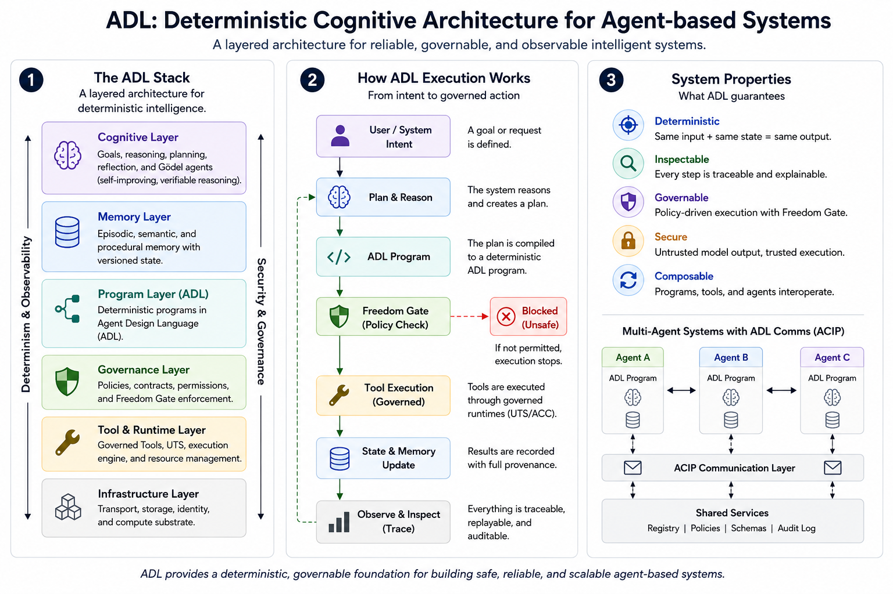

# Agent Design Language (ADL)

Agent Design Language is a deterministic cognitive architecture for building
agent-based systems that are reliable, governable, observable, and reviewable.

ADL is a Rust-backed language and documentation system for turning agent work
into explicit programs, governed tool calls, traceable artifacts, review
packets, demos, and milestone evidence. The public repository owns the language,
contracts and CLI; execution belongs to separately installed product owners.
See the [repository map](docs/REPOSITORIES.md) for Runtime, CodeFriend and
Cognitive-SDLC ownership.

[](https://github.com/agent-logic/agent-design-language/actions/workflows/ci.yaml)
[](https://github.com/agent-logic/agent-design-language/actions/workflows/ci.yaml)


Homepage: [agent-logic.ai](https://agent-logic.ai)

Coverage reports are retained by the public CI coverage job; the coverage badge
links to those runs and does not claim a coverage percentage.



The diagram presents the broader cognitive architecture. Its components span
the [owner repositories](docs/REPOSITORIES.md); they are not all implemented
in this public checkout.

## Table Of Contents

- [Why ADL Exists](#why-adl-exists)
- [What ADL Provides](#what-adl-provides)
- [Core Ideas](#core-ideas)
- [Quick Start](#quick-start)
- [Recent Demos And Proofs](#recent-demos-and-proofs)
- [Recent Milestones](#recent-milestones)
- [Documentation Map](#documentation-map)
- [Project Status](#project-status)

## Why ADL Exists

Agent systems are crossing from impressive prototypes into real operational
infrastructure. To make that transition safely, they need more than fluent
model output: they need durable programs, explicit authority, governed tools,
state you can trust, and evidence strong enough for teams to build on.

As these systems take on more authority, review and security work also need to
become continuous. Serious agent platforms cannot rely only on occasional audits
or after-the-fact explanations; they need workflows that can find, replay, and
repair weaknesses as part of normal operation.

ADL turns those requirements into an architecture for dependable agent systems:

- deterministic workflows that make agent behavior reproducible
- governed tools that separate model intent from runtime authority
- Freedom Gate policy checks before risky action
- traces, artifacts, and replay surfaces that make outcomes durable
- milestone proof packages that connect product claims to evidence

The project goal is simple: make agent-based systems safe enough to operate,
clear enough to trust, and structured enough to improve.

## What ADL Provides

The ADL architecture and its separately owned products have a substantial
platform baseline. This public repository supplies the language, schemas, tool
contracts and CLI dispatch; the following list also covers Runtime and
Cognitive-SDLC capabilities and retained design evidence:

- a Rust runtime and CLI for deterministic workflow execution
- explicit workflow, task, agent, provider, and tool artifacts
- bounded concurrency, retry, failure policy, signing, and verification
- run artifacts, traces, replay-oriented inspection, and review records
- governed tool calls through
  [UTS + ACC](docs/explainers/UTS_AND_ACC.md)
- traceable agent communication through [ACIP](docs/explainers/ACIP.md)
- Runtime v2 and CSM Observatory planning and proof surfaces
- Gödel agents and the
  [Gödel-Hadamard-Bayes algorithm](docs/milestones/v0.86/features/GODEL_HADAMARD_BAYES_ALGORITHM.md)
- structured PR/control-plane workflow with SIP, STP, SPP, VPP, SRP, and SOR records

For the retained capability matrix and roadmap, read the feature index.
Its historical entries do not establish current installed-product acceptance:
[docs/planning/ADL_FEATURE_LIST.md](docs/planning/ADL_FEATURE_LIST.md).

## Core Ideas

ADL starts with a deterministic runtime. Agent behavior is represented as
explicit programs, bounded state, policy decisions, and replayable artifacts so
intelligence can become infrastructure instead of an unreproducible transcript.

- The ADL runtime and
  [CSM](docs/explainers/CSM.md), the Cognitive Spacetime Manifold, are the
  foundation: they turn agent intent into governed, replayable execution inside
  a persistent runtime world with durable traces, artifacts, state transitions,
  causality, identity continuity, and operator-visible observability.
- [AEE](docs/explainers/AEE.md), the Adaptive Execution Engine, is ADL's
  adaptation lineage: bounded strategy selection, recovery, learning, and
  policy-aware execution without hidden magic.
- The
  [red/blue adversarial security model](docs/explainers/RED_BLUE_SECURITY.md)
  makes attack, defense, exploit replay, and purple-team coordination part of
  the runtime evidence story rather than a separate theater exercise.
- [Gödel agents](docs/explainers/GODEL_AGENTS.md) are the long-running
  direction for self-reference, self-improvement, and reviewable adaptation
  inside the deterministic runtime.
- The
  [Gödel-Hadamard-Bayes algorithm](docs/milestones/v0.86/features/GODEL_HADAMARD_BAYES_ALGORITHM.md)
  is the cognitive loop behind that work: structured awareness, controlled
  hypothesis generation, and evidence-weighted judgment before authorized
  action.
- [UTS + ACC](docs/explainers/UTS_AND_ACC.md) gives the runtime governed tools:
  portable tool shape stays separate from permission, visibility, redaction,
  and audit evidence.
- [ACIP](docs/explainers/ACIP.md) gives agents a communication layer for
  conversation, consultation, delegation, review, handoff, and negotiation that
  remains traceable by the runtime.

## Quick Start

Install Git and Rust through rustup. The repository pins Rust 1.92.0 in
[rust-toolchain.toml](rust-toolchain.toml). Build and inspect the public CLI:

```sh
git clone https://github.com/agent-logic/agent-design-language.git
cd agent-design-language
cargo run --locked --manifest-path adl/Cargo.toml --bin adl -- --help
```

Print a workflow plan without credentials or model-provider calls:

```sh
cargo run --locked --manifest-path adl/Cargo.toml --bin adl -- adl/examples/v0-3-fork-join-seq-run.adl.yaml --print-plan
```

This resolves two branches followed by a join. It prints the plan without
executing its tasks. See the [expected output](demos/README.md#runnable-from-a-public-clone)
and [public build guide](docs/PUBLIC_BUILD.md). There is no root Cargo workspace;
select the package manifest explicitly.

Execution requires a separately qualified installation from the relevant
[owner repository](docs/REPOSITORIES.md). Follow the
[public CLI selector contract](adl/README.md#selected-product-owners); private
sibling source checkouts are not required to build the public CLI.

## Recent Demos And Proofs

Start with the [current demo index](demos/README.md). The public CLI can resolve
and print a workflow plan without credentials, provider calls or private source:

```sh
cargo run --locked --manifest-path adl/Cargo.toml --bin adl -- adl/examples/v0-3-fork-join-seq-run.adl.yaml --print-plan
```

The example resolves two branches and a join; it does not execute their tasks.
The demo index includes the expected output and three offline packet examples:
CodeBuddy review, architecture documentation and an arXiv manuscript workflow.
These generate bounded fixtures, not completed product reviews or publication.

Current public proof entrypoints are:

- [Public CLI checks](tools/public_adl/run_cli_ci.sh): dependency boundaries,
  CLI dispatch/refusals, public contract tests and package/CLI version consistency.
- [Public package checks](tools/public_adl/run_package_checks.sh): schemas, UTS,
  language/compiler and legacy-contract libraries.
- [Public build guide](docs/PUBLIC_BUILD.md): supported build and validation setup.

Run the checks from the repository root:

```sh
bash tools/public_adl/run_cli_ci.sh
bash tools/public_adl/run_package_checks.sh
```

These checks validate public source contracts. Installed Runtime, CodeFriend and
C-SDLC acceptance belongs to the [respective owners](docs/REPOSITORIES.md).
For older demonstrations and dated proof records, see the
[historical demo catalog](demos/HISTORICAL_INDEX.md).

## Recent Milestones

### v0.93.2 - Current Delivery Plan

The current cross-repository plan focuses on CodeFriend Beta 1 and enterprise
security. The public ADL package version is `0.93.2`; this version bump does not
by itself declare the milestone complete or authorize a product launch.

- [Overview](docs/milestones/v0.93.2/README.md)
- [Sprint plan](docs/milestones/v0.93.2/SPRINT_v0.93.2.md)
- [Release criteria](docs/milestones/v0.93.2/RELEASE_PLAN_v0.93.2.md)

### v0.93.1 - Repository Split And Delivery Evidence

The retained milestone records cover the repository split and cross-repository
delivery work. Its publication candidate is dated evidence, not proof that every
current product has been qualified or deployed.

- [Overview](docs/milestones/v0.93.1/README.md)
- [Publication candidate](docs/milestones/v0.93.1/publication-1236/RELEASE_NOTES_CANDIDATE.md)

### v0.93 - Deferred Planning Baseline

The original v0.93 scope was subsequently split. Use the successor allocation
register for current ownership rather than treating the old candidate list as
an active delivery commitment.

- [Historical planning overview](docs/milestones/v0.93/README.md)
- [Successor allocation register](docs/milestones/v0.93.2/REALLOCATION_1296.json)

See the [roadmap and milestone index](docs/ROADMAP.md) for the full history and
status references. Historical milestone documents remain available unchanged.

## Documentation Map

- [Feature list](docs/planning/ADL_FEATURE_LIST.md): canonical capability
  overview and roadmap truth.
- [Explainers](docs/explainers/README.md): short entrypoints for UTS + ACC,
  ACIP, AEE, red/blue security, Gödel Agents, and CSM.
- [Docs index](docs/README.md): repository documentation entrypoint.
- [Changelog](CHANGELOG.md): milestone-level project history.
- [ADRs](docs/adr/README.md): architecture decisions.
- [GHB algorithm](docs/milestones/v0.86/features/GODEL_HADAMARD_BAYES_ALGORITHM.md):
  cognitive loop behind Gödel-agent work.
- [Examples](adl/examples/README.md): runnable ADL examples.
- [Demos](demos/README.md): demo-oriented proof surfaces.
- [AGENTS.md](AGENTS.md): repository-local operating contract for coding agents.

## Project Status

- Current delivery plan: [v0.93.2](docs/milestones/v0.93.2/README.md).
- Public `adl` package version: `0.92.1`, as declared in [adl/Cargo.toml](adl/Cargo.toml).
  Package versions and cross-repository milestone numbers are distinct.
- Primary implementation language: Rust.
- Public scope: ADL language, schemas, tool contracts and CLI dispatch.
- Runtime, CodeFriend and Cognitive-SDLC implementations and qualification belong
  to their [repository owners](docs/REPOSITORIES.md).
- Historical milestone records retain their dates and acceptance boundaries;
  current progress and remaining release gates are recorded in the
  [roadmap](docs/ROADMAP.md).

ADL is under active development. Treat milestone documents as bounded engineering
records: they distinguish implemented work, demos, active execution and plans.
A source change or passing CI does not establish installed-product or release
acceptance.

## Contributing, Security And License

Start with [contributor guidance](CONTRIBUTING.md), the [review guide](REVIEW.md)
and [public build guide](docs/PUBLIC_BUILD.md). Report language and public CLI
issues in the [ADL issue tracker](https://github.com/agent-logic/agent-design-language/issues);
route product defects through the repository map. Follow [SECURITY.md](SECURITY.md)
for sensitive reports.

Public packages declaring `MIT OR Apache-2.0` are available under either
[MIT](LICENSE-MIT) or [Apache-2.0](LICENSE), at your option. Package-specific
declarations and third-party notices continue to apply; historical Apache-only
packages retain their existing terms.
