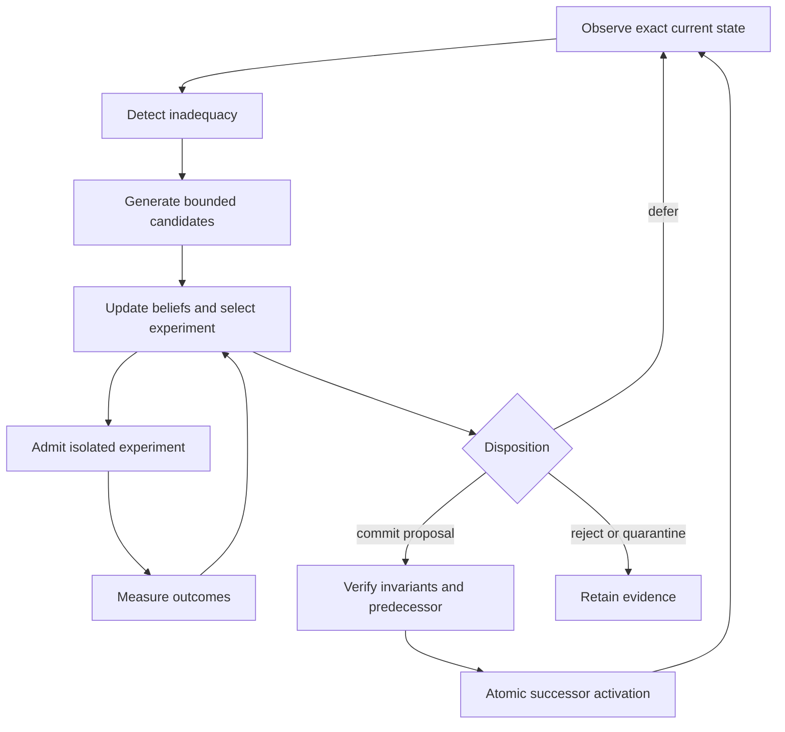

# GHB: design, evidence, and research

Status: proposed design. Date: 2026-10-10. Scope: ADL contracts, Runtime execution, installed contract distribution, and the separate GHB paper repository.

## 1. Intended outcome

Implement Gödel–Hadamard–Bayes as a live cognitive and improvement loop. A resident agent must observe its own failures, form competing explanations, generate bounded interventions, select experiments, revise beliefs from measured results, and submit improved body versions for authorized activation. Accepted successors must actually perform subsequent work. Identity, memory provenance, capabilities, continuity, and rollback must survive the transition.

The deliverable is not satisfied by generating proof-shaped JSON, changing a confidence field, producing a better answer within one prompt, or storing a proposed mutation that is never activated.

Two related loops share infrastructure but have different outputs:

1. Task cognition: reason about the current task and submit an authorized action or answer.
2. Agent improvement: treat the agent's own prompt, policy, tools, workflow, or implementation as the candidate object; evaluate a successor and submit an activation proposal.

An agent need not rewrite itself on every task. Improvement cycles should be triggered by accumulated failures, model inadequacy, drift, or an explicit objective, with budgets and stopping rules.

## Runtime delivery contract

The operator requires this algorithm to work on the installed Agent Logic Runtime. Runtime owns the executable GHB controller, belief updates, candidate orchestration, experiment scheduling, persistent archive, resident memory integration, promotion consumption and successor loading. Pure computational helpers may be shared libraries, but the installed Runtime must package and invoke them through production callers. ADL supplies versioned declarations and schemas; it must not become a required sibling source checkout or an alternate resident executor.

WP00 must identify the current supported Runtime release, install artifact, deployment topology, entrypoints and state paths. This packet deliberately does not assume that historical Runtime v2 contract modules describe the current deployment. Pin the actual artifact and configuration for qualification.

The normal resident scheduler must initiate or resume GHB cycles with bounded concurrency, cancellation and backpressure. Inference and tools use Runtime's existing adapters and authority checks. Durable beliefs, pending experiments, archive references and active-body lineage must survive process replacement. A candidate body change must be consumed by the next eligible task, with in-flight work either pinned to its old version or explicitly drained under a documented policy.

Installed acceptance runs in a clean environment containing the release artifact, installed contracts, configured providers and durable state. It must not depend on ADL development binaries, fixture constructors, local source paths, manual receipt copying or a developer switching branches between cycles. The independent evaluator can run separately, but Runtime must submit the experiment and verify and consume the authentic returned result.

Required evidence joins resident ID, cycle ID, provider/tool invocation, candidate digest, trial outcome, posterior update, promotion disposition, activated body and subsequent task. Restart and rollback must exercise the same installed entrypoints. Missing provider access, stale package versions and unavailable evaluator results produce explicit incomplete/deferred states.

## 2. Current evidence and gaps

Paths below are relative to the named repository. Absence statements concern the inspected surfaces, not a proof that no related implementation exists anywhere in the organization. WP00 must complete the production-caller inventory before adding new owners.

| Evidence | Current support | Remaining gap |
| --- | --- | --- |
| ADL `docs/milestones/v0.86/features/GODEL_HADAMARD_BAYES_ALGORITHM.md` | State analysis, alternatives, evidence evaluation, deterministic envelope, thinking/action boundary | Normative executable semantics and statistical contracts |
| ADL `docs/milestones/v0.89/ideas/GHB_ALGORITHM_AND_STATE_SPACE_COMPRESSION.md` | Proposed compression interpretation | Changes Gödel to structure expansion and Hadamard to transformation; performance and compression claims need measurement |
| ADL `docs/milestones/v0.89/ideas/GHB_EXECUTION_MODEL.md` | Observe/structure/explore/evaluate/commit, temporal anchors, memory and continuity | Fresh model invocation cannot promise identical outputs; replay semantics need precision |
| ADL `adl/src/godel/ghb_loop.rs` | Cycle packets, replay hashes, governance fields, negative cases | Proof construction explicitly classifies hosted routes without invoking them; not a production self-improvement loop |
| ADL `adl/src/godel/stage_loop.rs` | Bounded failure-to-index stage pipeline | Real experiment execution and live successor feedback |
| ADL `adl/src/godel/promotion.rs` | Upstream identity checks and persisted promotion artifacts | Fixed score beginning at 70 with bonuses and threshold 85 is not Bayesian inference or measured promotion |
| ADL `adl/src/runtime_v2/godel_agent_runtime.rs` | Agent/runtime contract surface | Must identify current installed Runtime consumer and avoid a competing execution owner |
| Runtime `adl-runtime-kernel/src/adaptive_learning.rs` | Existing adaptive-learning decisions and history surfaces | Audit exact mutable state, production callers, and overlap before implementing another learner |
| Runtime `adl-runtime-kernel/src/production_birthday.rs` | Durable activation, locking, receipt binding, recovery and conflicts | Real resident construction and consumption of authorities remains tracked in Runtime #112 |
| Runtime identity, continuity, capability and memory modules | Substantial reusable infrastructure | End-to-end GHB body activation and restored useful continuation |
| Paper `GODEL_HADAMARD_BAYES_SOURCE_PACKET.md` and claim packet | Explicit evidence/claim boundaries | Verified bibliography, measured results, source locks, and author-reviewed novelty analysis |

The inspected paper `refs/sources.bib` contains only a provisional-bibliography comment. Existing conceptual material should be preserved as historical context while a reviewed normative specification resolves inconsistencies.

## 3. Research interpretation

### Formal and empirical self-improvement

Schmidhuber's Gödel Machine requires a proof that a self-rewrite improves expected utility under its axioms and computational costs. It does not establish that every useful improvement is tractably provable. This program adopts mechanically verified invariants plus empirical performance evaluation; it must not inherit the original machine's optimality claims.

Gödel Agent investigates LLM-driven modifications to agent logic. Darwin Gödel Machine uses an archive of variants and empirical evaluation to discover improvements. These support an archive and experiment architecture, but their reported results are not evidence of ADL's performance. Reflexion supports an earlier memory-based adaptation stage without requiring parameter training.

Bayesian experimental design supplies a principled method for selecting informative experiments. High-confidence policy improvement motivates conservative comparison against a baseline under uncertainty. Guarantees from finite or batch reinforcement-learning settings do not automatically transfer to an open-ended LLM agent; ADL must state its own assumptions and evidence limits.

Hadamard's account of mathematical invention provides historical inspiration for creative exploration. Neither Hadamard's name nor Gödel's incompleteness theorem provides a correctness theorem for this architecture. GHB is an ADL-defined composition whose benefits require independent evaluation.

### Primary references

| Source | Use in this proposal | Limitation |
| --- | --- | --- |
| [Schmidhuber, Gödel Machines](https://arxiv.org/abs/cs/0309048) | Formal self-reference and utility-aware rewrite criterion | Our empirical implementation does not satisfy this full formal definition |
| [Gödel Agent](https://arxiv.org/abs/2410.04444) | Agent logic as an object of improvement | Benchmark findings are domain-specific |
| [Darwin Gödel Machine](https://arxiv.org/abs/2505.22954) and [official repository](https://github.com/kew-lab/darwin-godel-machine) | Variant archive, stepping stones, isolated candidate evaluation | Reward hacking and generalization remain central concerns |
| [Reflexion](https://arxiv.org/abs/2303.11366) | External feedback and episodic reflective memory | Reflection alone is not body-level recursive improvement |
| [Modern Bayesian Experimental Design](https://arxiv.org/abs/2302.14545) | Expected information gain and experiment allocation | Requires explicit models and manageable inference cost |
| [High Confidence Policy Improvement](https://proceedings.mlr.press/v37/thomas15.html) | Baseline comparison and uncertainty-aware promotion | Published guarantees depend on their assumptions |
| [Safe Policy Improvement with Baseline Bootstrapping](https://proceedings.mlr.press/v97/laroche19a) | Retain baseline behavior when evidence is sparse | Not a universal safety guarantee for software modifications |
| [Hadamard, publisher-hosted text](https://assets.press.princeton.edu/about_pup/PUP100/book/fulltext.pdf) | Historical creative-invention framing | Inspiration rather than executable algorithm specification |

The literature pass is sufficient to inform this implementation proposal, not an exhaustive systematic review. WP12 must verify bibliographic metadata, versions, licenses for any reused code, and novelty boundaries. No external code is proposed for direct import by this packet.

## 4. Proposed normative algorithm

### State

Represent a cycle as `S = (identity, body, observations, beliefs, memory_head, continuity_head, constraints, budget, archive_head)`. Every reference is versioned and content-addressed where practical. Observations retain source, time, collection method, trust classification, and dependencies on earlier observations.

### Transitions

1. **Observe:** collect admitted observations and reconstruct the current state. Separate facts, model judgments, and unknowns. Freeze the parent body, memory snapshot, policy, and evaluation version for this cycle.
2. **Gödel:** identify inadequacy: contradiction, unexplained failure, capability deficit, miscalibration, drift, or an objective that current behavior cannot meet. Produce a structured problem and explicit competing explanations. This is an operational limitation detector, not a general mathematical undecidability oracle.
3. **Hadamard:** generate, recombine, and refine candidates against that problem. Record predicted effects and falsification tests. Enforce candidate count, mutation surface, branch depth, resource limits, and diversity.
4. **Bayes:** update beliefs from admitted evidence, assess uncertainty, and select an experiment, candidate, or deferral. Evidence may return the loop to Gödel or Hadamard when the hypothesis family is inadequate.
5. **Experiment:** obtain separate experiment admission, execute in isolation, and record measured outcomes. Experimental action is still action and requires authority before execution.
6. **Disposition:** submit evidence and a proposed outcome: commit, reject, quarantine, or defer. A commit recommendation alone is not activation.
7. **Activate and retain:** the Runtime authority validates the exact predecessor and permitted mutation, then atomically activates a successor. Retain experiment evidence and approved memory updates. Next-cycle execution must use the accepted successor.

### Termination

Stop a cycle on exhausted budget, unavailable authority, inadequate evidence, candidate exhaustion, no credible improvement, violated invariant, or accepted activation. A failure to improve is a valid result. Do not force promotion to make a demonstration pass.

## 5. Statistical design

Use `P(h|e) proportional to P(e|h)P(h)` only where hypotheses and likelihoods have a declared meaning. A model's verbal confidence is an observation from an imperfect source, not an authoritative posterior.

Initial implementation should use tractable models: Beta-Binomial estimates for appropriately modeled success rates, categorical models for failure classes, and empirical paired differences for continuous costs. Separate task strata and retain trial seeds and dependence information. Repeated measurements from correlated runs must not be counted as independent evidence.

For open-ended explanations without reliable likelihoods, preserve an explicit `unmodeled` or `qualitative_evidence` status. Do not fabricate probabilities. Add evidence adapters incrementally with calibration tests.

Choose experiments by expected information gain or expected decision value minus cost, subject to hard constraints. Information gain and production utility are different: an informative candidate may be unsuitable for activation. Declare priors, utility weights, acceptable regression margins, confidence/credible thresholds, trial limits, and stopping rules before evaluating the candidate.

Promotion uses a multi-objective comparison: task quality, reliability, latency, tokens, monetary cost, and critical failure rate. Hard invariant failures cannot be averaged away by a better quality score. The first domain should use a fixed benchmark and paired baseline trials; later sequential testing must account for repeated selection and adaptive search.

## 6. Body, archive, and memory

The agent body descriptor binds identity root, parent body, source and build digests, prompt/policy/workflow/tool bundles, provider configuration, objective version, capability envelope, evaluation suite, and activation receipt. A model change is an explicit body/configuration transition with compatibility evaluation.

The candidate archive is a DAG of evaluated variants. An archived variant is not necessarily authorized to run in production. Parent selection can combine measured utility, uncertainty, novelty, and lineage distance. Keep a protected production head distinct from search branches.

Memory has three separate classes: immutable observations and outcomes; derived summaries with source references; and adopted behavioral state. Summary compression must be evaluated on retrieval, contradiction preservation, and future task performance. Preserve links to source evidence rather than deleting unfavorable observations. Peer reports require provenance and are not independent merely because they came from different agents.

State-space compression remains a research hypothesis until a benchmark demonstrates reduced storage/context cost while preserving declared observables and useful performance. Do not claim causal preservation from a summary alone.

## 7. Execution, identity, and authority

ADL owns declarative contracts, schemas, compile-time validation and installed distribution. Runtime owns resident scheduling, actual provider/tool execution, durable state, experiment processes, identity and activation. The paper repository owns scholarly presentation and claim reconciliation. Locate the existing appropriate owner before choosing new modules.

Candidate sandboxes start from an exact body snapshot and use explicit capabilities, isolated storage, bounded network access, and cost limits. Evaluator secrets and hidden tests stay outside candidate write/read access. Distinguish deterministic controlled-adapter tests from separately budgeted live-provider experiments.

Reuse the current production-birthday store. Runtime #112 requires authentic authorities constructed and consumed by the actual resident cycle, no test-support substitutes, explicit activation, exactly one birthday, and useful continuation after restart. Body activation is a subsequent continuity transition, not another birth event.

The activation protocol must reject stale parents, conflicting writers, incompatible body/memory migrations and missing evidence. Prepare immutable candidate and evidence records; validate; persist an intent; commit the authoritative head; reconcile interrupted operations; then clean staging separately. Reuse existing continuity transaction mechanisms rather than creating a parallel receipt authority.

Rollback is itself an authorized forward lineage event selecting a prior compatible body. It must not erase history or blindly rewind memory, identity age, or external effects. Define migration compatibility and fail closed when restoration is unsafe.

Normal mutations may eventually include search policy and proposer logic. Capability ceilings, identity roots, evaluator integrity and external authority rules are not self-granted. Changing these requires a separate reviewed authority transition. Initial source-code promotions require operator review; automation can expand only after qualification under an explicit policy.

## 8. Replay and observability

Replay consumes retained observations, model outputs, tool outcomes, configuration, seeds, versions, and state transitions. It validates the original decision process without invoking live side effects. A new provider call is a new experimental trial, even with identical prompts.

Retain structured decisions and evidence, not hidden reasoning transcripts. Redact credentials and sensitive task content. Define retention and access controls for prompt/output artifacts needed for reproducibility. Emit machine-readable payloads on stdout and human events on stderr, following existing policy. Trace cycle, candidate, experiment, parent body, evaluator, decision and activation identifiers across owners.

## 9. Proposed conformance and full implementation criteria

| Level | Required behavior |
| --- | --- |
| G0 | Typed GHB artifacts and inspectable stage ordering |
| G1 | Real candidate experiments and calibrated evidence updates |
| G2 | Build and evaluate isolated modified agent bodies |
| G3 | Durable resident identity, authentic birthday, activation lineage, recovery and rollback |
| G4 | Accepted successors improve bounded improvement machinery and perform subsequent cycles |
| G5 | Reserved research category for formally justified self-rewrites under explicit axioms; outside delivery scope |

These levels are proposals. Assign them only with exact-version evidence, not by checking whether a module name exists. The target is G4 plus domain-specific qualification. G0 roughly describes the inspected ADL GHB proof surface; this is not a complete assessment of every existing resident.

Full delivery requires: authentic production callers; measured updates rather than fixed fixture scores; an activated successor used on later tasks; independently held-out evaluation; lineage surviving interruption/restart; protected evaluator and authority boundaries; budget enforcement; and a documented fleet migration path. This establishes tested capabilities within declared domains, not guaranteed perpetual improvement, consciousness, personhood, or mathematical global optimality.
