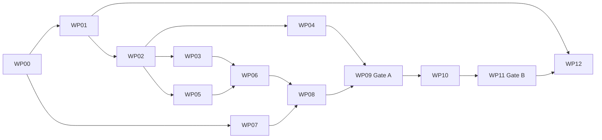

# GHB implementation execution plan

Date: 2026-10-10. Status: proposed; work-package IDs are local planning IDs, not created GitHub issues. See [design](DESIGN_AND_RESEARCH.md) and [estimate](ESTIMATE.md).

## Mandatory Runtime target

All delivery gates run through the installed `agent-logic-runtime` resident path. Runtime is the executable owner; ADL is the contract/specification owner. Qualification must work from installed artifacts without an ADL checkout or a development-only GHB runner.

Before Gate A, demonstrate this chain in the installed service: normal resident wake/task → GHB cycle → Runtime provider/tool calls → admitted experiment → measured result → posterior update → authorized activation → subsequent task using the successor → service restart → useful continuation with the same identity and retained lineage. Record the exact release, configuration and body digests. Fixture output alone cannot satisfy any live integration claim.

## Delivery boundaries

**Gate A — useful persistent improvement:** one authentic resident detects a task failure, generates candidates, executes real bounded experiments, updates quantitative beliefs, activates an independently evaluated successor, survives restart, and uses that successor on subsequent tasks. This corresponds to the proposed G3 profile.

**Gate B — qualified recursive improvement:** a successor changes an allowed part of its improvement machinery, performs another improvement cycle, and passes independent transfer, recovery and authority tests. A fleet migration/conformance path exists. This corresponds to G4. Successful recursion does not imply guaranteed monotonic improvement forever.

Use a bounded software-maintenance domain first: isolated repository tasks with executable tests, fixed tool capabilities, and measurable resource use. Begin with retrieval, prompt and workflow adaptations; enable bounded source changes after the same evaluation/activation contract works. Scientific discovery and arbitrary domains are later domain packs, not prerequisites for Gate B.

## Ownership and dependency rules

- Program owner: dependency order, scope, budget, evidence ledger and release decisions.
- ADL contract owner: schemas, specification, distribution and compatibility.
- Runtime owner: execution, adaptive learning, identity, state, activation and recovery.
- Evaluation owner: task splits, hidden evaluator, statistical protocol and independent outcomes.
- Reviewer: independent bounded review of each change, plus cross-owner acceptance review.

These are roles, not staffing assignments. The estimate assumes three implementation lanes and shared review capacity. Do not have concurrent agents edit the same owner module. Package/contract revisions must be pinned at each integration gate.

Before implementation: refresh repository heads and issue state, inventory existing owners and active work, create or map issues through the current typed lifecycle, create all required cards from current templates, bind FastWork worktrees, and create issue-bound goals. Review before publication; include closing keywords and required CI. This packet itself does not initiate those writes.

## Work packages

### WP00 — source-to-caller audit and baseline

Owner: program + Runtime. Dependencies: none.

Inventory all actual callers of GHB, adaptive learning, provider execution, memory, body/config changes, continuity and birthday. Map every required behavior to an existing owner, missing integration, or new implementation. Refresh Runtime #112 and coordinate with its current owner. Record the actual supported Runtime release, deployment topology, installed package versions, service entrypoints and durable state paths, and baseline tasks/results. Select the first domain, fixed task split, mutation permissions and cost envelope.

Acceptance: source-to-caller matrix at pinned revisions; no duplicated owner planned; runnable unchanged-agent baseline; measurable Gate A scenario; approved evaluation protocol and task/data licenses. A missing existing owner is an explicit gap rather than assumed absence.

### WP01 — normative specification and invariants

Owner: ADL. Dependencies: WP00.

Resolve phase semantics, task/improvement loops, termination, replay, evidence provenance, mutable/protected surfaces, identity/body distinction and conformance profiles. Write a proposed ADR and migration mapping from existing proof packets. Define typed rejection and recovery conditions.

Acceptance: every transition has inputs, outputs, authority, side effects and stop conditions; fresh inference versus replay is explicit; historical docs link to the normative successor after review; conformance labels remain proposed until accepted.

### WP02 — schemas and installed contract parity

Owner: ADL. Dependencies: WP01.

Implement observation, belief, hypothesis, candidate, body, experiment, trial, posterior, disposition, activation and lineage contracts. Reuse existing record types when compatible. Version semantic changes explicitly; distribute through the established installed contract path.

Acceptance: canonical digest/round-trip tests, malformed and stale-reference rejection, schema examples, installed Runtime compatibility test, and a migration policy for existing artifacts. New tests are classified in the validation inventory when authored.

### WP03 — belief update and experiment selection

Owner: Runtime algorithm lane; exact module selected by WP00. Dependencies: WP02.

Implement tractable posterior models, likelihood adapters, calibration metrics, paired baseline comparison, unknown-evidence handling, information gain/value-of-information selection, resource costs and stopping rules. Keep model-based confidence separate from observed outcomes.

Acceptance: analytically known posterior fixtures; zero/impossible likelihood handling; correlated evidence cannot be silently double-counted; replay reproduces updates; informative experiments can differ from high-utility candidates; sparse evidence defers promotion.

### WP04 — candidate generation and archive

Owner: Runtime algorithm lane. Dependencies: WP02; integrate WP03 selection after initial archive support.

Add proposer interfaces, typed interventions, predicted effects, falsification tests, candidate diversity/deduplication, parent selection, archive DAG, and bounded search. Retain rejected and inconclusive variants with provenance. Provider adapters supply actual outputs in separately budgeted trials.

Acceptance: candidate changes match the declared mutation class; exact parent and proposal provenance retained; archive cannot change production head; budget exhaustion terminates cleanly; at least two distinct useful candidate strategies are exercised.

### WP05 — isolated body builder and experiment executor

Owner: Runtime/execution. Dependencies: WP02.

Build candidate bodies from immutable parents in isolated worktrees/containers; use explicit capability and resource admission; compile/package as needed; run tasks with captured outputs and declared effects. Protect production credentials, evaluator data and production state.

Acceptance: denied network/filesystem/capability escapes; killed and timed-out experiments leave no production changes; exact candidate digest in results; measured resource accounting; controlled-adapter and live-provider execution classifications remain distinct.

### WP06 — independent evaluator and promotion decision

Owner: evaluation lane. Dependencies: WP00 protocol, WP02 contracts, WP03 statistics, WP05 executor.

Implement development, selection and untouched final test splits; paired trials; quality/cost/reliability metrics; regression invariants; sequential-selection controls; evaluator versioning; and commit/reject/quarantine/defer decisions. Add candidates that intentionally alter tests, suppress failures, leak hidden tasks or falsify metrics.

Acceptance: these malicious/invalid candidates fail; raw outcomes can be independently recomputed; unseen final tasks are excluded from candidate context; thresholds declared before trials; non-improvement is a legitimate terminal outcome. Promotion recommendation cannot itself activate a body.

### WP07 — resident birthday and continuity integration

Owner: Runtime. Dependencies: WP00 audit; coordinate/reuse Runtime #112 rather than opening a duplicate.

Complete production resident construction/consumption of identity, continuity, memory, capabilities, profile, adaptive history and witness authorities. Preserve the existing transaction store. Add explicit activation and useful continuation after restart.

Acceptance: Runtime #112's actual-resident positive/negative criteria pass without test-support authority substitutes; no implicit birthday on startup; one birthday under retry/concurrency/interruption; authenticated restored resident performs a useful task.

### WP08 — successor activation and rollback

Owner: Runtime. Dependencies: WP02, WP05, WP06, WP07.

Bind a promotion proposal to exact parent, candidate, evaluation version and capability envelope. Reuse continuity transactions for durable activation and recovery. Record rollback as a forward lineage transition. Define memory/body migration compatibility and staged cleanup.

Acceptance: failpoints at durable boundaries; stale parents and concurrent conflicting activations reject; crash recovery yields one authoritative head; accepted successor is actually loaded; rollback restores compatible execution without erasing history or replaying external effects.

### WP09 — live GHB resident loop and Gate A

Owner: Runtime resident integration. Dependencies: WP03–WP08.

Wire observation, inadequacy detection, generation, experiments, posterior updates, decision, activation, memory and continuation into the normal installed resident execution path. Package every executable dependency in the Runtime distribution; add configuration compatibility, startup checks, durable migration handling, and version pinning or draining for in-flight work. Add cycle scheduling, budgets, cancellation, structured logs, traces, redaction and offline replay. Prevent runaway improvement triggers.

Acceptance: full Gate A scenario from a clean installed Runtime environment with no ADL source checkout or development binaries; separate controlled-adapter regression and live-provider evidence; successor handles later tasks; replay performs no external mutations; two competing cycles cannot both activate against one parent. Export an exact-version evidence packet.

### WP10 — bounded recursive improvement

Owner: Runtime algorithm and activation owners. Dependencies: Gate A.

Allow candidates to modify a bounded proposer, search-policy or experiment-allocation component. Define immutable authority/evaluator boundaries and compatibility checks. Retain both the original baseline and successor lineage. Require initial human review of source changes.

Acceptance: at least one admitted successor changes improvement behavior and executes the next cycle using that change; independent tests verify the change did not modify protected evaluation or authority rules. If no improvement emerges within budget, report the capability as implemented but empirical improvement unproven; do not manufacture acceptance.

### WP11 — longitudinal qualification, fleet adoption and Gate B

Owner: evaluation + Runtime. Dependencies: WP10; test design begins during WP06.

Run held-out transfer, multiple model/provider configurations, phase ablations, restart/migration, corrupted input, concurrency, rollback and reward-hacking campaigns. Inventory each resident's compatible body/capability profile. Define opt-in rollout, shadow operation, canary, monitored promotion, abort and rollback criteria.

Acceptance: qualification matrix names each tested domain/configuration; one resident reaches Gate B with useful post-restore continuation; every intended fleet profile is either qualified, pending or excluded with a reason; no blanket claim that all agents qualify from one demonstration. Rollout authorization is separate from local qualification.

### WP12 — research evidence and operator documentation

Owner: docs/research, with independent review. Dependencies: WP01 for vocabulary; WP11 for final claims.

Curate bibliography and related-work comparison; update paper claims only from exact source/experiment receipts. Publish internal operator runbooks for start, inspect, defer, quarantine, recover and rollback. Document model/data versions, costs, failed experiments and limitations.

Acceptance: claim-to-evidence ledger; reproducible benchmark instructions; installed command/manual parity where applicable; no unsupported theorem, novelty, personhood or general-performance claim. Scholarly publication is outside this plan's authorization.

## Sequencing and schedule

Indicative three-lane schedule, measured from staffed kickoff:

| Window | Main work | Review milestone |
| --- | --- | --- |
| Weeks 1–2 | WP00, WP01, baseline protocol; audit/start existing WP07 lane | Scope and contract review |
| Weeks 2–3 | WP02; establish installed Runtime loading and invocation smoke slice; begin evaluator fixtures and bibliography | Installed schema parity |
| Weeks 3–5 | WP03, WP04, WP05; continue WP07 | Real experiments, posterior updates, archive |
| Weeks 5–7 | WP06, WP08, WP09 integration | Gate A demonstration and review |
| Weeks 7–9 | WP10 and targeted hardening | Actual recursive successor cycle |
| Weeks 9–12 | WP11, WP12; longitudinal observation and repairs | Gate B qualification packet |

This is a planning range, not a committed date. Eight weeks is an aggressive favorable case; 10–12 is the base planning window; 16–20 is the risk case. Critical dependencies are WP00 → WP01 → WP02 → executor/statistics → evaluation → activation → live loop → recursion → qualification. WP07 can become the critical path if its integration gap is larger than current evidence suggests.

## First five working days

1. Freeze baselines, identify active owners, map Runtime #112, and choose bounded tasks and metrics.
2. Review semantics, mutation boundaries, failure dispositions and body/identity contract.
3. Finalize schema changes and installed-consumer migration; begin a minimal observation-to-trial fixture.
4. Implement initial posterior adapter and baseline trial capture in separate owner paths.
5. Review the smallest vertical contract slice; replace estimated token/review/build costs with measured values and reforecast the remaining plan.

No source implementation should begin by rewriting all existing GHB modules. Prefer small vertical integrations that preserve current proof fixtures as regression evidence while routing production through real owners.

## Validation and release discipline

Each implementation issue needs focused local proof, CI lane mapping, independent pre-PR review, exact revision receipts and truthful cards. No blanket full-suite runs unless touched invariants warrant them. Qualify positive and negative production callers, not only record constructors. Controlled adapters prove logic; a separate live experiment proves provider integration; longitudinal evidence proves continuity over the observed interval only.

The program is complete only at Gate B with WP12 evidence reconciled. Individual work packages may finish earlier. A model failing to discover an improvement is an experimental result requiring diagnosis or scope revision, not permission to relax promotion thresholds.
