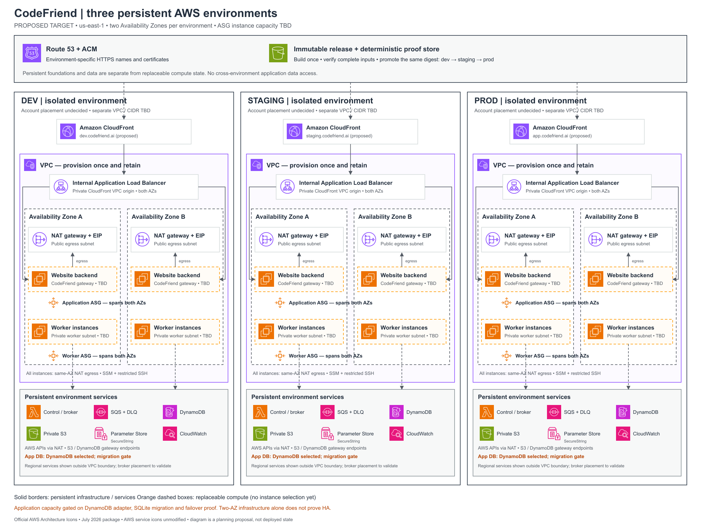

# CodeFriend: persistent dev, staging and production environments

Status: PROPOSED; planning and cost estimate only. Date: 2026-11-13.

## Objective and operating rule

Create three environments once, each spanning two Availability Zones. Reuse the architecture and persistent infrastructure. Routine releases change individual code modules, not the architecture, networks or supporting apparatus. Instance types, counts, architecture and purchasing options remain TBD.

Reduce time and repeated work through immutable module artifacts, explicit compatibility contracts, affected-module validation and authenticated deterministic proof reuse. This proposal does not provision AWS resources, migrate existing ownership, change active cleanup guards, authorize a recurring budget or claim Sprint 4 qualification.

## Architecture diagram

[Scalable SVG](AWS_ARCHITECTURE.svg). Official AWS July 2026 service/resource icons are unmodified; the layout uses AWS service colors and VPC/AZ boundaries. The diagram shows intended capabilities, not deployed state or selected instance counts. Dashed compute boxes are placeholders. Regional service placement is logical; broker VPC placement must be selected before infrastructure approval. The ALB is one persistent regional resource attached to application subnets in both AZs.

## Environment contract

| Environment | Purpose | Foundation | Compute |
| --- | --- | --- | --- |
| Dev | Development and integration | Persistent; isolated data and credentials | TBD; independently replaceable |
| Staging | Production-like qualification | Same module topology as production; separate data and credentials | TBD; independently replaceable |
| Prod | Customer operation | Persistent; isolated production data and credentials | TBD; independently replaceable |

Initial region: us-east-1. Proposed names: dev.codefriend.ai, staging.codefriend.ai and app.codefriend.ai. Domain ownership, existing records and TLS/OAuth callbacks must be reconciled before use. Account placement is explicitly undecided: one Agent Logic business account with three isolated VPCs is the lower-operational-overhead starting option; three accounts remain an alternative with stronger account-level isolation. Use separate VPCs, IAM roles, secrets, buckets, tables, queues and state backends either way; do not represent VPC isolation as account isolation. AWS Organizations itself has no additional service charge; extra accounts chiefly add administration and may lead to duplicated per-account services/security tooling. The same three VPCs/NATs/ALBs cost the same in this estimate regardless of account placement. Account and recurring-budget decisions remain open. CIDRs and exact AZ IDs remain TBD until organization IPAM/account inventory is checked. Do not assume AZ letters identify the same physical AZ across accounts.

Every environment has two AZs and three subnet classes per AZ: public controlled egress, private application and private workers. Total planned network shape: three VPCs and eighteen subnets. The private ALB spans both application subnets; CloudFront uses a private VPC origin. An internet gateway is required by CloudFront VPC-origin prerequisites but is not a public route to the origin. All application and worker instances have outbound NAT access, using the NAT gateway in their own AZ. Instances retain private IPs; NAT access does not make them publicly reachable. SSM Agent and an SSH server/client access path are required on all instances. Use SSM for ordinary management; provide SSH through Session Manager tunneling or an approved private management/VPN route, with SSH key/IAM control. No public inbound port 22 and no always-on bastion are assumed. Network connectivity does not grant provider-effect permission: application IAM/consent/broker controls still govern those effects. This is a target-architecture revision, not authorization to alter the current qualification campaign network.

The application ASG diagram label means Website backend plus CodeFriend gateway: the Node.js Website owns browser-facing sessions/jobs/results, and its gateway client calls the separate native CodeFriend service API. Co-placement on the application ASG is proposed, not a claim of a merged executable or a new AWS API Gateway service. Independent code-module/version boundaries remain.

## Three independently owned layers

1. Foundation: VPC, subnets, routing, S3/DynamoDB gateway endpoints, NAT (paid interface endpoints optional only for a demonstrated requirement), security groups, DNS, certificates, CloudFront, ALB and stable target groups. Provision once; retain across releases and instance replacement.
2. Persistent services and data: IAM roles/policies, SSM Parameter Store SecureStrings (service-managed KMS key unless a demonstrated requirement calls for a customer-managed key), control/broker service identities, SQS/DLQ, DynamoDB, private S3, monitoring, state/locks and backup policies. Retain resource identity; update code/config through compatible releases.
3. Compute and code: one application ASG and one worker ASG per environment, each configured with both private AZ subnets (six ASGs total), plus versioned native gateway and broker code. Keep ASG identity, launch-template identity, scaling policies and target-group attachment persistent; publish versioned launch-template/image/config changes and use controlled instance refresh when needed. Use ALB health for application targets and readiness/draining lifecycle hooks for queue workers. Instance types, min/desired/max, Spot/On-Demand and scale metrics remain TBD; provision no workload capacity until those values are selected. Replace instances when necessary; do not automatically replace them for every module update. Ephemeral disks are disposable; durable data is not.

Use a reusable environment module with separate backend/state boundaries per environment and layer. Pin module/provider versions and record an environment inventory of addresses, physical IDs, outputs and architecture-contract version. Ordinary code deployments must not run Terraform apply. Infrastructure changes use a separate reviewed plan, preserving stateful identities and explicit migration/rollback steps. State separation and lifecycle safeguards must protect the foundations; do not rely solely on prevent_destroy as a complete deletion control.

## Module delivery: change only what changed

Proposed release units are Website/UI, native gateway/runtime adapter, worker executor, broker/control functions, and shared contract/schema packages. Confirm actual packaging boundaries before claiming independent deployment. Existing archive/manifest and native-owner checks remain authoritative until supported module-level packaging is implemented.

Each module artifact is immutable and identified by content digest, source revision, dependency lock, toolchain, interface/schema versions and provenance. An environment release manifest selects module digests and configuration references. A normal release:

1. Determines changed modules and their transitive contract/test dependencies.
2. Builds changed modules once and stores immutable artifacts and proof in a dedicated S3 namespace/bucket with version IDs and digest checks.
3. Retrieves trusted deterministic proof for unchanged identical inputs; runs changed-module and affected-interface checks.
4. Promotes the same verified artifact bytes through dev, staging and prod; records environment-specific configuration and deployment receipts separately.
5. Performs bounded installation/health/contract checks and atomically selects the new supported version, with the previous release manifest retained for rollback.

Proof-cache keys include all behavior-affecting source, dependencies, fixtures, test/runner logic, tool/runtime versions, platform and declared environment inputs. Misses or invalid provenance run the required proof; they must not produce synthetic passes. Untrusted PRs cannot populate a trusted success namespace. Hash/validate receipts and immutable object versions; use least-privilege read/write roles and deliberate retention. Do not cache credentials, customer source, model prompts/results or mutable state as generic proof. Successful deterministic tests do not replace fresh IAM, account, service-health, deployment, migration, live-provider, recovery, cleanup or hosted-qualification evidence.

Architecture changes are exceptional: new services, routes, privileges, ports, queue contracts or incompatible schemas require an explicit architecture-contract revision. Routine module releases must fail if they require an undeclared infrastructure mutation. Database changes need backward-compatible expand/contract migrations or a separately reviewed migration; rollback must account for irreversible data changes.

## Current-state constraints and reuse

The current qualification base state has 46 managed instances at its retained serial 47, including one EC2 instance and 45 non-instance managed resources. This is an adoption baseline, not proof of three provisioned environments or a fresh live inventory. Frontdoor and additional endpoints have separate ownership/state. Map and import suitable existing resources rather than rebuilding them; preserve exact ownership and exclude other sessions' resources.

Current temporary 72-hour cleanup contracts cannot be silently relabeled persistent infrastructure. Before adoption, reconcile exact resource custody, funding, guard coverage and terminal conditions through supported owner routes. Preserve existing guards until replacement custody is genuine; avoid orphaning resources or double ownership. Campaign cleanup may remove only campaign-owned instances/objects and must exclude adopted persistent foundation/data resources.

Website app/store.mjs currently uses local SQLite and explicitly excludes shared/network filesystems. Two-AZ infrastructure does not create multi-active application safety. Durable application database/failover design remains a separate prerequisite: use the operator-selected DynamoDB backend, implement/test its adapter and SQLite migration, then qualify failover. No RDS deployment or price is implied by this plan. DynamoDB control state is not a substitute for Website application storage.

## Provisioning plan

| Step | Deliverable / exit condition |
| --- | --- |
| 1. Inventory and mapping | Exact existing-resource IDs, ownership, account/region/AZ IDs, DNS, state and cleanup contracts; adopt/reuse/new disposition for every resource |
| 2. Freeze architecture v1 | Account placement, nonoverlapping CIDRs, subnet classes, optional endpoint exceptions, NAT egress/broker contracts, persistent-data strategy and module interfaces |
| 3. Establish state and artifact custody | Environment/layer state backends and locks; private immutable artifact/proof namespaces and trusted CI roles |
| 4. Provision persistent foundations | All three environments, two AZs each; missing shared apparatus created once; no workload instances selected or launched |
| 5. Prove idempotence and reuse | Second identical plan is zero-change; instance/module replacement leaves foundation/data IDs unchanged; unauthorized replacements fail closed |
| 6. Complete module delivery | Changed-module dependency selection, trusted proof reuse, release manifests, exact artifact intake and rollback |
| 7. Select compute | ASG launch templates, instance types/counts/Spot policy and bounds chosen separately; minimum healthy targets and failover posture explicitly qualified |
| 8. Promote and operate | Dev -> staging -> prod, same artifact digests; fresh installation/health/security/failover evidence and independent acceptance |

Persistent environments remain funded and retained until a deliberate retirement action; instance schedules do not destroy the network. Budgets/alerts, owner tags, deletion controls and separate persistent-versus-campaign cleanup inventories are required. Provisioning new recurring infrastructure is outside the existing temporary Sprint 4 $40 allowance.

## Monthly cost estimate

Planning estimate in USD, us-east-1, 730 hours/month, checked 2026-11-13. No discounts, credits, free-tier allowances, tax or existing-resource credits assumed. All three environments use the same two-AZ foundation. This is a gross target operating estimate, not the current bill or an incremental migration quote.

| Component | Assumption per environment | Per environment / month | All three / month |
| --- | --- | ---: | ---: |
| Zonal NAT gateways | 2 x 730 h x $0.045/h | $65.70 | $197.10 |
| NAT public IPv4 | 2 x 730 h x $0.005/h | $7.30 | $21.90 |
| Internal ALB fixed charge | 1 x 730 h x $0.0225/h | $16.43 | $49.28 |
| ALB capacity assumption | Average 1 LCU x 730 h x $0.008 | $5.84 | $17.52 |
| Interface endpoints | None by default: all instances reach public AWS APIs through NAT | $0.00 | $0.00 |
| EC2 Auto Scaling groups | 2 persistent ASGs per environment; underlying capacity TBD | $0.00 service fee | $0.00 service fee |
| S3/DynamoDB gateway endpoints | No endpoint hourly charge | $0.00 | $0.00 |
| Route 53 | 1 delegated public hosted zone | $0.50 | $1.50 |
| KMS key storage | Service-managed encryption by default; customer-managed keys optional | $0.00 | $0.00 |
| **Foundation subtotal** | Includes modeled 1-LCU usage; excludes traffic processing | **$95.77** | **$287.30** |

Totals use unrounded line values; displayed cents can differ by a cent when multiplied. The latest operator instruction assumes NAT access, SSM and SSH for every instance. Therefore SSM, ssmmessages, SQS, STS, execute-api and CloudWatch public API connectivity uses same-AZ NAT; none has a mandatory paid VPC endpoint in this target. Keep S3/DynamoDB gateway endpoints, which have no endpoint hourly fee. Add a paid interface endpoint only for a concrete security, availability or traffic-cost requirement. One service in both AZs would add about $14.60/month/environment plus processing. Existing campaign worker no-NAT/SQS endpoint contracts remain separate until explicitly migrated; no deployed route or endpoint was removed for this plan.

The diagram uses the official SSM Parameter Store icon with SecureString; customer-managed KMS keys are optional. Standard Parameter Store parameters have no additional storage charge; advanced parameters, high-throughput APIs and applicable KMS usage are additional. Current retained SQS uses SQS-managed encryption and results S3 uses AES256. No KMS interface endpoint or customer-managed key is assumed solely for encryption at rest. Each unrotated customer-managed key, if actually required, adds $1/month plus requests; rotation can add storage charges.

AWS EC2 Auto Scaling has no additional fleet-management service fee; EC2, EBS, monitoring and related resources remain billable. The diagram does not select instances or assert that two AZs automatically prove application HA.

Additional explicitly modeled low-usage allowances (estimates, not AWS unit-price quotes): dev $20/month, staging $35/month, prod $100/month, and $10/month shared artifact/proof storage and operations. These cover a small assumed mix of CloudFront requests/transfer, S3 operations/storage, SQS/DynamoDB/Lambda usage, logs, key requests and processing. They are budget placeholders without a traffic forecast, not guaranteed upper bounds.

**Working total: approximately $452/month for all three environments before instances, instance disks, application database, backups, model/provider usage, CI runner minutes, optional WAF/security services and taxes.** Carry a provisional **$452-$600/month planning range** for this modeled non-compute footprint; it is not a hard cap. Larger storage, log, request or transfer volumes can exceed it. CloudFront pricing plan selection, WAF, snapshot retention, additional endpoints, NAT processing and cross-AZ transfer require explicit workload inputs. Do not assume zero cost merely because compute is stopped.

Compute remains TBD. Monthly additions are calculated as sum(instance hourly price x running hours x count), plus EBS provisioned storage/IOPS/throughput and snapshots. DynamoDB schema, workload costs, migration and application failover qualification remain pending, so no complete production operating total is claimed. Reuse existing suitable resources and report incremental costs after inventory; do not subtract presumed credits/refunds.

## Acceptance criteria

- Exactly three independently controlled environments; two AZs and six subnet slots per environment; application and worker ASGs span both AZs, with compute selection explicit. All instances have same-AZ NAT access, SSM and a restricted SSH access path. Account count remains undecided.
- Same architecture-contract/module topology; environment-specific data, Parameter Store SecureStrings, IAM and state; no implicit cross-environment production access.
- Infrastructure created/adopted once; repeat plan zero-change; code-module releases do not recreate apparatus.
- Instance replacement preserves all declared foundation/data identities and does not erase application data.
- Trusted proof reuse demonstrated by a hit for identical inputs and misses/refusals for changed inputs, tampered receipts and untrusted producers.
- Same artifact digest promoted across environments, with environment-specific health and qualification evidence and proven rollback limits.
- Cost inputs, actual recurring budget and cleanup custody reconciled before provisioning/adoption.
- No multi-AZ application availability claim until data and failover behavior are implemented and proved.

## Evidence and sources

Current source: app/store.mjs in CodeFriend; retained fleet-staged-projection module network.tf, fleet.tf, jobs.tf, control.tf and results.tf; retained fresh-owned state baseline. These establish current components/constraints, not the proposed three-environment completion.

AWS references checked for this proposal:

- [EC2 Auto Scaling pricing](https://aws.amazon.com/ec2/autoscaling/faqs/)
- [AWS Organizations pricing](https://docs.aws.amazon.com/organizations/latest/userguide/orgs_introduction.html)
- [SSH through Session Manager](https://docs.aws.amazon.com/systems-manager/latest/userguide/session-manager-getting-started-enable-ssh-connections.html)
- [Official architecture icons](https://aws.amazon.com/architecture/icons/)
- [CloudFront VPC origins](https://docs.aws.amazon.com/AmazonCloudFront/latest/DeveloperGuide/private-content-vpc-origins.html)
- [ALB two-AZ subnet requirements](https://docs.aws.amazon.com/elasticloadbalancing/latest/application/application-load-balancers.html)
- [NAT gateway AZ resilience](https://docs.aws.amazon.com/vpc/latest/userguide/nat-gateway-basics.html)
- [NAT and public IPv4 cost formula](https://docs.aws.amazon.com/AWSEC2/latest/UserGuide/using-instance-addressing.html)
- [ALB pricing](https://aws.amazon.com/elasticloadbalancing/pricing/)
- [PrivateLink pricing](https://aws.amazon.com/privatelink/pricing/)
- [AWS example of $0.01 endpoint/AZ-hour](https://aws.amazon.com/blogs/security/access-accounts-with-aws-management-console-private-access/)
- [Route 53 pricing](https://aws.amazon.com/route53/pricing/)
- [KMS pricing](https://aws.amazon.com/kms/pricing/)
- [CloudWatch agent network prerequisites: endpoints for private subnets without NAT](https://docs.aws.amazon.com/AmazonCloudWatch/latest/monitoring/prerequisites.html)

## Artifact validation and boundary

SVG and PNG rendered with official unmodified AWS icons and visually inspected. Pricing arithmetic independently reproducible in COST_MODEL.json. File links checked; no infrastructure apply, CI dispatch, publication or cloud mutation performed for this document. Final account placement, CIDRs, endpoint list, DynamoDB schema/migration, compute and recurring budget remain decisions. The plan and diagram are local ignored planning artifacts under .adl/docs/TBD, created at the operator's explicit requested location; no tracked main files were changed.

## GitHub and CodeBuild CI proposal

GitHub remains the source, pull-request, review and check interface. CodeBuild-hosted ephemeral GitHub Actions runners are the proposed execution option; direct CodeBuild GitHub webhooks/buildspecs are an alternative. Reuse the existing suitable private S3 cache rather than create apparatus per run. Builds must use exact source, locked tools/dependencies and immutable artifacts; only unchanged complete inputs may reuse trusted proof. Run changed-module/affected-interface and environment-dependent checks as required. Trusted publishers and untrusted PR execution need separate permissions. No long-lived AWS keys in GitHub or the guest. Required connection/project/role/image/cache-prefix and provenance-contract changes are a separately reviewable implementation, not an activated service in this plan.

The current ADL AWS CodeFriend build-lane document explicitly marks its launcher retired and its successor disabled. Consult the current infrastructure owner implementation; do not run the historical ADL setup/dispatch commands or broaden the existing legacy shared role. Current package intake pins producer/workflow/runner evidence and must be intentionally qualified for CodeBuild rather than relabeling old GitHub-hosted proof.

CodeBuild is not in the fixed monthly foundation subtotal. Example only: 500 small-Linux build minutes at $0.005/minute are $2.50 before free-tier allowances; larger runners, logs, storage, network and any pipeline charges are additional. Pin the actual runner choice/region and workload before a CI operating estimate is accepted. See [CodeBuild GitHub runners](https://docs.aws.amazon.com/codebuild/latest/userguide/action-runner.html) and [CodeBuild pricing](https://aws.amazon.com/codebuild/pricing/).

## Discussion decision log and unresolved choices

- Three persistent logical environments: dev, staging, prod; two AZs each; instance sizes/counts/purchasing remain TBD.
- Provision/adopt once. Routine module releases must not recreate subnets, routes, endpoints, roles, queues, tables, buckets, frontdoors or other apparatus. Existing compatible resources should be reused.
- Latest target supersedes the earlier isolated/no-NAT worker proposal: all instances use same-AZ NAT, SSM and restricted SSH. Application and worker ASGs each span both AZs. Current campaign isolation contracts are not silently altered.
- Account placement is undecided. Do not turn the initial three-account recommendation into an approved decision. One account with three VPCs is an option; three accounts add administrative separation/overhead, not an inherent Organizations service fee.
- No paid interface endpoints by default with NAT available. CloudWatch, SQS, SSM, STS and control API exceptions require a demonstrated need. SSM management uses ssm/ssmmessages; Parameter Store alone does not require ssmmessages. Keep free S3/DynamoDB gateway endpoints.
- KMS is not a baseline standalone component. Parameter Store/SecureString replaces the misleading KMS/secrets diagram label. Customer-managed keys are optional for a concrete requirement; do not weaken existing encryption.
- EIPs are attached to public NAT gateways, one per AZ. The internal ALB has private addresses and no EIP. CloudFront is the inbound public entry path; NAT provides outbound access. Static inbound EIP requirements would be a separate design decision involving a suitable service.
- Website backend and CodeFriend gateway are separate code modules proposed for the application ASG; workers execute in the worker ASG. Co-placement is a proposal, not implementation proof. Local SQLite storage/failover must be resolved before multi-active application claims.
- Same immutable module artifacts move dev -> staging -> prod. S3 deterministic-proof reuse is input/provenance-bound; cache hits do not replace live qualification, account/IAM, runtime or cleanup evidence.
- Current modeled foundation $287.295/month; explicit usage allowances $165/month; total $452.295/month before instances, EBS/database/backups/model/CI/security extras. Earlier $725/$680/$671 estimates are superseded by latest NAT/no-default-endpoint/service-managed-key assumptions.
- The target architecture is proposed only. No provisioning, account creation, current guard cancellation, recurring-budget acceptance or production cutover was performed.

## Review and equivalent GCP deliverable

The operator explicitly requests independent Claude and Gemini reviews of this exact AWS packet, then an equivalent GCP plan after AWS review findings are resolved. Planning #15 owns the follow-on issue, review coordination and GCP packet. Preserve exact reviewed document/diagram/cost-model hashes, provider/model identities and actual outcomes; never claim a provider review ran unless it did. Use existing approved provider routes/authentication without scanning or exposing credentials. This instruction does not renew or consume a separate qualification window by implication.

Both reviewers should assess architecture correctness, two-AZ failure behavior, ASG/stateful-service compatibility, NAT/endpoint duplication, private inbound/SSH/SSM, secrets/key handling, account isolation tradeoffs, recurring cost arithmetic/exclusions, module-only releases, deterministic-proof validity, rollback/migration and persistent-versus-campaign cleanup ownership. Reconcile all findings and explicit residual disagreements. A review is not deployment approval.

Only after AWS review/reconciliation, produce a GCP equivalent with official Google Cloud icons, two zones per environment, managed instance groups, outbound NAT, private management/SSH, corresponding ingress/data/queue/secrets/observability/CI/artifact services, and the same cost methodology: 730 hours, no selected workload instances, separately labeled traffic/storage/build/model/database extras. State provider semantic differences rather than drawing a literal AWS service rename: GCP VPC/subnet/NAT scope, regional MIG behavior, IAM/project/account boundaries, queue acknowledgement/replay semantics and database persistence require explicit mapping. Compare one-versus-three GCP projects/billing organization without assuming equivalence to three AWS accounts. Planning/review scope does not authorize GCP deployment or new cloud credentials.

### Required GCP review gate

Operator clarification: the GCP plan, cost model and official-icon diagram must ALSO receive actual independent Claude and Gemini reviews. Preserve exact packet hashes/model identities/results, reconcile all actionable findings and residual disagreements, and only then mark the GCP packet reviewed. Completion requires both reviewed AWS and reviewed GCP packets, not AWS review alone.

## Operator decision: DynamoDB application backend (2026-11-13)

DynamoDB is selected for the Website application database backend, replacing the earlier database-choice TBD. This is an architecture decision, not evidence that the existing SQLite implementation has been migrated. Keep existing DynamoDB control-state tables distinct from the application table design and permissions.

Before application ASG capacity is launched or expanded, define and implement supported DynamoDB access patterns for sessions, jobs and results, partition/sort keys, indexes, conditional writes, idempotency, pagination, consistency and transaction requirements. Confirm the implementation against actual Website storage semantics. Specify retention/TTL (including asynchronous deletion), backup/PITR, encryption, environment separation and migration/rollback. Do not translate SQL transactions or queries into assumed DynamoDB equivalents. Regional DynamoDB service durability does not prove application failover or remove application-state/connection/draining requirements.

The existing local SQLite backend must never serve a multi-active application deployment. Desired application capacity remains unselected and gated on implemented/qualified DynamoDB storage. Preserve both-AZ ASG configuration as the target; do not silently select single-AZ topology or instance counts. Migration must reconcile exact records and prevent concurrent divergent writes. Rollback after DynamoDB writes requires an explicit data strategy; selecting an older binary alone is insufficient.

DynamoDB request, storage, index, backup/PITR and optional stream costs need workload inputs and a separate application-data estimate. The existing $452.295 modeled total remains a partial non-compute baseline with database costs excluded; selecting DynamoDB does not make those costs zero. No RDS instance is planned for the application backend. Account placement and compute remain undecided.

## AWS review reconciliation requirements

These are proposed implementation acceptance requirements, not claims of implemented controls. Claude and Gemini reviewed the earlier pinned packet; the DynamoDB amendment and these clarifications require final review.

### Launch and funding gates

Before any paid foundation provisioning or adoption: approve account placement, recurring funding owner and budget/alert thresholds, resource custody, CIDRs/subnet headroom, ingress contract and DynamoDB design. Before application capacity: implement and qualify DynamoDB storage/migration and select ASG bounds, N-1 AZ capacity and recovery targets. No SQLite-backed multi-active application launch is permitted. Three persistent environments and two AZs each remain the target; review does not authorize staging fewer environments or selecting instance counts.

### Account decision and residual risk

One versus three accounts remains OPEN by operator instruction. Three accounts provide stronger IAM, administrative and quota boundaries; this is the reviewer recommendation, not an accepted mandate. A one-account choice requires explicit acceptance of shared administrative/quota blast radius, narrowly scoped roles and resource policies, permission boundaries where applicable, isolated state and data, quota alarms and independently controlled production access. VPCs alone do not isolate IAM. Organizations SCPs apply to member accounts and are not a substitute for same-account identity controls. Record decision owner and exception rationale before provisioning.

### Ingress and management contract

Only public egress subnets route to the IGW. Application/worker subnet defaults route to their own AZ NAT; disable automatic public IP assignment and check routes, SGs and launch templates for exposure. Restrict the internal ALB SG to the CloudFront VPC-origin service-managed SG after origin creation, using the documented bootstrap allowance only during controlled setup. Specify origin HTTPS certificate/hostname and Host forwarding, cache behavior that does not cache authenticated sessions, OAuth callbacks and allowed headers/methods before integration. Reserve ALB/ENI subnet headroom. WAF/rate-limit posture and its excluded costs require a production decision.

Website is the browser-facing ALB application target. Its private client calls the separate CodeFriend gateway module on an explicit internal port and contract; co-placement does not automatically expose the gateway publicly. Define per-module ports, health checks and credentials. Any separately routed public gateway target requires an explicit contract revision.

SSM and restricted SSH remain required. Prefer SSH through Session Manager with public ingress 22 denied; any private VPN access is a separately specified route and SG exception. Scope StartSession by environment/role, require strong operator authentication and attributable, revocable SSH credentials. Record session metadata and supported shell-session logs with approved retention; SSH tunnel contents are not recorded by Session Manager. NAT failure removes management access in the affected AZ: document this limitation, drain/replace through supported controls, and review a separately bounded emergency path if required. Do not imply free independent management connectivity or silently add paid endpoints.

### Trusted proof and promotion

Only deterministic, hermetic lanes are cache-eligible. Pin source/dependency graph and graph-generator version, runner/test logic, OS/container digest, toolchain, fixtures, locale/timezone/seed and declared inputs. Network/time/live-provider dependent lanes require fresh execution. Unknown inputs cause a miss. Authenticate producer identity and receipt signatures/attestations under a protected trust root; a matching hash alone is insufficient. Trusted and untrusted CodeBuild projects/roles must be separate with enforced storage-policy namespaces, no untrusted trusted-cache writes or publisher-role assumption, and exact GitHub repository/ref/environment trust conditions. Reuse an existing bucket only after its policy and principals prove the same isolation; otherwise use a dedicated reviewed namespace/bucket. Pin dependency inputs and define build egress policy. Periodically bypass cached proofs to detect hidden-input drift.

Promote identical module digests with environment config receipts. Require N/N-1 message/schema compatibility, idempotent jobs, bounded queue visibility/heartbeat, worker drain and duplicate-delivery handling. Use a reviewed deployment selector/manifest and retain prior digests. Data migration uses expand/contract gates; rollback after writes must preserve data and cannot be equated with selecting an old binary. Human/owner promotion authority and CodeBuild producer qualification remain prerequisites.

### Adoption custody and failure qualification

Per resource, reconcile exact physical ID, current state owner, cleanup predicate and supported exclusion route. Do not import a resource while another active state/cleanup actor can mutate it. A reviewed owner handoff must preserve protection continuously, verify an exclusion/dry-run and backups/deletion controls, transfer exclusive state ownership, verify IDs and a zero-change plan, and prove campaign cleanup is a no-op for persistent inventory before retiring old custody. If supported ordering cannot be proved, defer adoption or provision an independently owned resource under separate approval. This plan changes no existing guards.

| Failure | Detection and required response | Qualification gate |
| --- | --- | --- |
| One AZ lost | ALB readiness removes failed targets; surviving app/worker capacity serves load; SQS redelivery remains idempotent | Select N-1 capacity and test actual recovery against explicit RTO/RPO |
| Same-AZ NAT/API egress lost | Worker queue age, dependency probes and application readiness detect stalled work; EC2 status alone is insufficient | Prove alarms, bounded worker lease/drain/replacement and no duplicate effects |
| Instance refresh or module rollback | Connection drain, queue heartbeat and compatible persisted schemas preserve work | Interrupted-job and N/N-1 release tests |
| DynamoDB throttling or migration error | Conditional failure handling, backoff, capacity alarms and migration reconciliation | Define access-pattern budgets, consistency and data recovery tests |
| Regional outage | Outside the two-AZ availability promise | Explicitly accept single-region scope; no cross-region DR claim |

RTO/RPO values and thresholds are required pre-provisioning decisions; none is invented here. Broker placement must be selected before infrastructure approval; if VPC-attached, specify both-AZ subnets and NAT/API access. Multi-AZ managed services do not establish end-to-end availability.

### Cost sensitivity and exclusions

Keep the verified 730-hour subtotal: $287.295 for three foundations including assumed ALB LCU usage; $165 usage allowances; $452.295 partial modeled total. NAT processing is variable: $0.045 × aggregate processed GB, in addition to hourly NAT and internet transfer. Illustrative 100 GB/environment adds $13.50 for three environments if incremental to the allowance; it is not a traffic forecast and must not be double-counted against allowances. Internet transfer, cross-AZ transfer and actual ALB LCU dimensions need separate volume inputs. DynamoDB application requests, storage, indexes, backup/PITR and streams remain excluded pending workload design. The total is neither an idle-cost minimum nor a production operating quote: allowances and LCU usage are modeled consumption, and compute/database are missing.

## Review completion and remaining decision register

Claude Sonnet 5.5 and Gemini 3.1 Pro Preview returned COMPLETE REVIEW on the pinned AWS review-v2 packet. Their reviews accept planning completeness while retaining provisioning gates; neither is deployment approval. Final bounded independent review and consistency changes are recorded separately.

| Required decision | Accountable role | Gate if unresolved |
| --- | --- | --- |
| Account placement and IPAM/CIDRs/ALB headroom | Agent Logic operator with infrastructure owner | Step 2 cannot exit; escalate to operator, no automatic default |
| Funding owner identity, recurring budget and alarm thresholds | Agent Logic operator (budget approver); infrastructure owner (cost inventory) | No paid provisioning/adoption at step 4 |
| RTO/RPO and N-1 capacity posture | Product/service owner with infrastructure owner | Architecture freeze must record targets; compute remains TBD until separately selected |
| DynamoDB keys/indexes/access patterns/capacity mode and workload costs | CodeFriend Website storage owner with infrastructure owner | No app rollout; no finalized operating budget without workload estimate |
| Broker placement, gateway ports/health/credentials, ingress TLS/Host/cache and optional origin-header authentication | CodeFriend service owner with infrastructure owner | Step 2 contract freeze; no guessed ports or public gateway exposure |
| WAF/rate limits for each public environment, including accepted-risk none if chosen | Security owner with operator | Before exposing any environment; include selected cost |
| Emergency management path versus accepted NAT dependency | Infrastructure/security owner with operator | Before instance launch; default plan claims no independent emergency path |
| CodeBuild size/image/network and producer qualification | Infrastructure/CI owner | Before CI configuration changes or trusting its artifacts |
| Dev/staging/prod promotion approvers | Product release owner; operator designates production approver independent of artifact producer | No stage promotion until role identities and checks recorded |

Roles above are accountability assignments for planning; exact people, account IDs and workload values remain to be supplied by the responsible operator/owner before the gate. Do not treat an unfilled gate as permission to proceed. DynamoDB global tables and cross-region disaster recovery are outside this single-region proposal.

Step 1 requires a fresh authenticated inventory in the approved adoption window immediately before custody changes; the historical serial-47 count is not an actionable current inventory. Step 2 includes the full decision register above. No stale baseline may authorize adoption.

DNS costing assumes one delegated public hosted zone per environment (three total); the shared Route 53/ACM diagram band groups service types and does not denote one shared zone. Parent-zone/domain costs, if incremental, require inventory; they are not silently included. The $452–$600 range begins at the rounded modeled working total and remains a provisional partial estimate, not a guaranteed bound.
